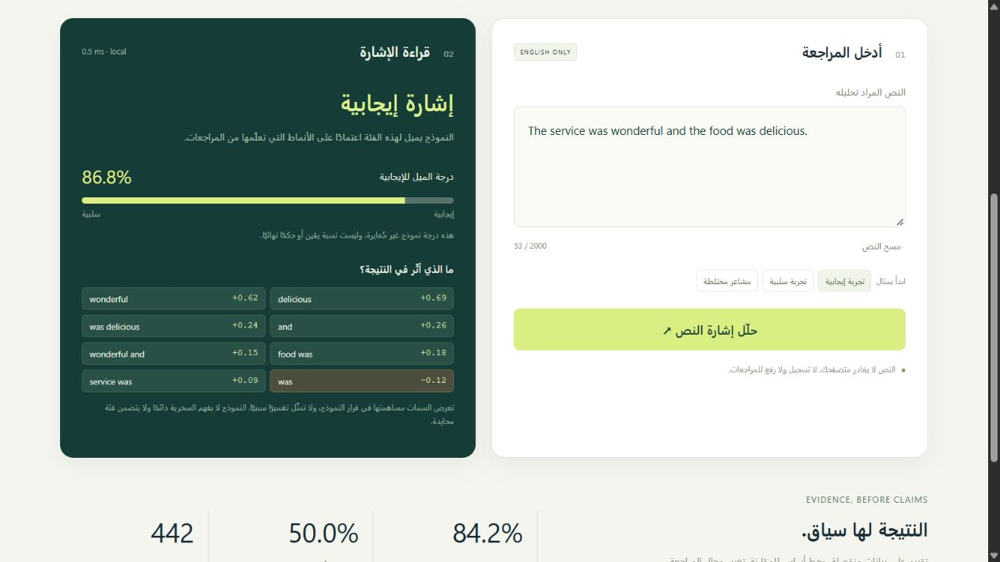

# Sentiment Lens

**A small NLP model you can inspect.** Classify English review sentiment in the browser and see the learned words and bigrams that contributed to the score.

[](https://github.com/moamendahshann/sentiment-lens/actions/workflows/ci.yml) · [دليل التشغيل بالعربية](START-HERE-AR.md)



## What makes this an AI project?

The model learns its vocabulary, TF-IDF statistics and logistic-regression weights from labelled data. Training and inference are implemented in JavaScript, using Node.js built-ins and browser APIs, with no external ML library, API key or remote prediction service. This is a classical machine-learning classifier, not an LLM or a hand-written sentiment lexicon.

## Recorded evaluation

| Measure | Result |
| --- | ---: |
| Raw labelled reviews | 3,000 |
| Reviews after global deduplication | 2,969 |
| Train / development / test | 2,085 / 442 / 442 |
| Held-out test accuracy | **84.16%** |
| Test macro F1 | **0.8415** |
| Majority-class baseline accuracy | 50.00% |
| Model features | 5,040 word unigrams and bigrams |

### When the domain changes

Each experiment below trains on two review sources and tests on the completely excluded third source. Model selection is performed only within the two available domains.

| Unseen domain | Test accuracy |
| --- | ---: |
| Amazon products | 77.5% |
| IMDb films | 70.4% |
| Yelp restaurants | 76.2% |

Cross-domain performance is lower than the mixed-source split. These results are from a small benchmark and do not establish performance on arbitrary reviews. See [full metrics, confusion matrix, validation trials and test errors](docs/metrics.json).

## Run locally

Install Node.js 24. No npm dependencies or API keys are required.

```bash
npm start
```

Open http://localhost:5180. On Windows, double-click **START.bat** instead. A trained model is included. After the source is downloaded, local serving and retraining work offline.

```bash
npm run train   # repeat training, model selection and domain holdouts
npm test        # check data, split boundaries, model behaviour and saved results
npm run build  # validate model and copy the browser application to dist/
```

## Training protocol

1. Parse 1,000 labelled sentences per source. Normalise text keys, deduplicate globally before splitting, and drop any conflicting-label groups.
2. Make a seed-42 split stratified by source and sentiment: approximately 70% training, 15% development and 15% test.
3. Learn TF-IDF word unigram/bigram features from training text only; retain features seen in at least two documents and L2-normalise each vector.
4. Train L2-regularised logistic regression with full-batch Adam. Compare C values 0.5, 2 and 8 using development macro F1, with log loss as the tie-breaker.
5. Refit vocabulary and model on training + development data using the selected C. Evaluate the untouched test split once.
6. Repeat domain holdouts independently, selecting C using only the remaining two sources.

The exported browser model is the train+development model used for the reported test score. It is not refitted on test data. Data hashes, seed, selected C and errors are recorded for reproducibility. Contributions are feature value × learned weight in the linear logit; they explain this model's computation, not causality.

## Browser experience and privacy

The interface is Arabic; the model supports **English reviews only**. Example inputs, per-feature contributions and model evaluation are included. Unsupported Arabic input and empty text get clear messages. Very low coverage or a score near 0.5 is shown as uncertain; this is an abstention heuristic, not a learned neutral category.

Predictions run locally after downloading the small model. Input text is not logged, recorded or sent to a server. Scores are **not calibrated confidence estimates**. There is no analytics or remote model call.

## Limitations

Sarcasm, mixed opinions, unfamiliar domains and vocabulary can confuse the model. Labels are binary; the source dataset intentionally excludes neutral examples. A random sentence split is not an author-independent or time-based benchmark. Deduplication does not remove all near-duplicates. Local tests and browser inspection do not establish real-world reliability. This is a student portfolio project developed with AI assistance, not a production moderation system.

## Project structure

- `src/model.mjs`: tokenizer, TF-IDF encoder, score and contributions; shared with browser inference.
- `src/train.mjs`: deduplication, stratified splitting, logistic-regression training and evaluation.
- `scripts/train.mjs`: reproducible experiment and artifact export.
- `web/`: application, exported model and measured results.
- `tests/`: meaningful data and model checks.
- `docs/metrics.json`: recorded evaluation; `data/`: attributed benchmark data.

## Data and license

Dataset: Kotzias, D. (2015). **Sentiment Labelled Sentences**, UCI Machine Learning Repository. [DOI: 10.24432/C57604](https://doi.org/10.24432/C57604). Review sources are Amazon, IMDb and Yelp. Dataset license: **CC BY 4.0**. See [data provenance](data/README.md).

Source code is licensed under MIT. Dataset files retain their separate CC BY 4.0 license and attribution.
